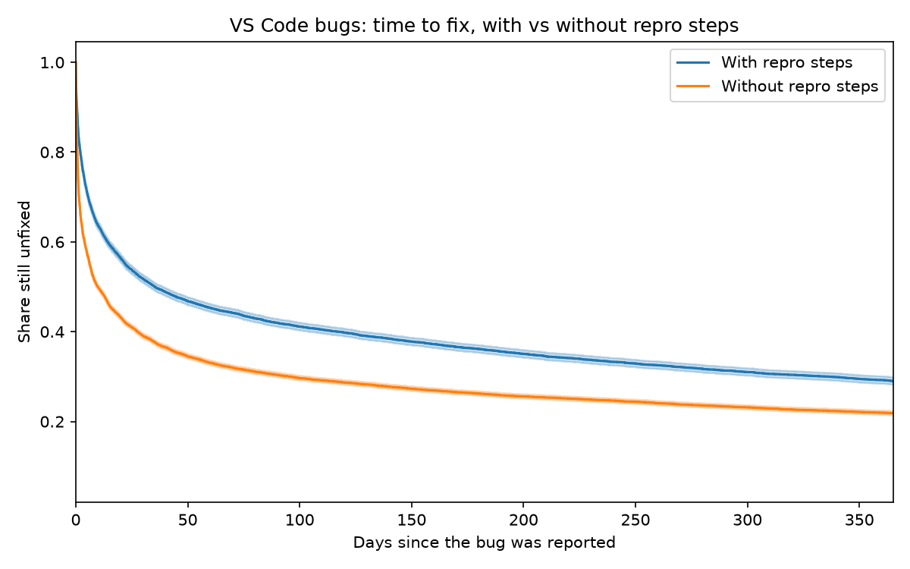

# FixClock: what makes VS Code bugs get fixed faster?

Survival analysis of 46,201 bug reports from microsoft/vscode (2016 to 2026).
Open issues are kept as censored observations, not dropped, so slow bugs are
not hidden.

## Findings

- **Typical fix takes 14.8 days (median)**; an estimated 24% of bugs are
  still unfixed after a year.
- **Reporter experience is the strongest factor.** First-time reporters wait
  a median of about 78 to 108 days; reporters with 50+ earlier bug reports,
  about 4 days. Adjusted for other features, a first-time reporter is linked
  to an 18% lower fix rate (hazard ratio 0.82, 95% CI 0.79 to 0.85).
- **A misleading raw result.** Bugs with repro steps looked much slower
  (median 35 vs 10 days), but that was confounding: first-time reporters
  write repro steps more often and wait longer. Adjusted, repro steps go with
  a small speedup (HR 1.06, CI 1.03 to 1.09), which is not robust: using only
  2022-onward bugs the interval includes 1.
- **Reporter experience helps mainly in the first two weeks.** The model's
  constant-effect assumption fails for four of five features (it holds for
  repro steps), so single hazard ratios are averages.
- **Prediction is modest.** On bugs from 2024 on (held out), concordance is
  0.633; reporter experience alone scores 0.635.

Full write-up with limitations: [memo/memo.md](memo/memo.md)

## Outcome definition

A bug counts as fixed only if it was closed as `completed` and carries no
non-fix label (`*duplicate`, `*out-of-scope`, `*not-reproducible`,
`*as-designed`, `*caused-by-extension`, `*question`, `*english-please`,
`*edu`). Everything else is censored: still-open bugs at the snapshot date,
and non-fix closures at their close date. GitHub backfilled `state_reason`
for old issues, so labels were needed to find hidden duplicates.

## Reproduce

1. `python -m venv venv`, activate it, `pip install -r requirements.txt`
2. Put a GitHub token (public repos, read-only) in a `.env` file:
   `GITHUB_TOKEN=...`
3. Run from the project root, in this order:
   - `py src/download.py` (resumable; takes a while)
   - `py src/build_tables.py` (outcome and duration)
   - `py src/features.py`
   - `py src/km_repro.py`, `py src/km_strata.py`
   - `py src/cox_model.py`, `py src/ph_test.py`, `py src/cox_windows.py`
   - `py src/holdout.py`, `py src/robustness.py`
   - `py src/build_lookup.py` (writes `dashboard/lookup.json`)
4. Dashboard: `cd dashboard`, then `py manage.py runserver`

The `data/` folder is not in the repository; step 3 recreates it.

## Limitations

Association, not causation: bug difficulty and affected component are not in
the model. Features are rough (repro steps means a filled-in "Steps to
Reproduce" section; reporter experience counts earlier bug reports in this
dataset only). Only bug-labeled issues from one repository. Recent non-fix
closures may not be labeled yet. The dashboard shows historical group
averages, not predictions for an individual bug.

Stack: Python, pandas, lifelines, Django, plain HTML/CSS/JS.
